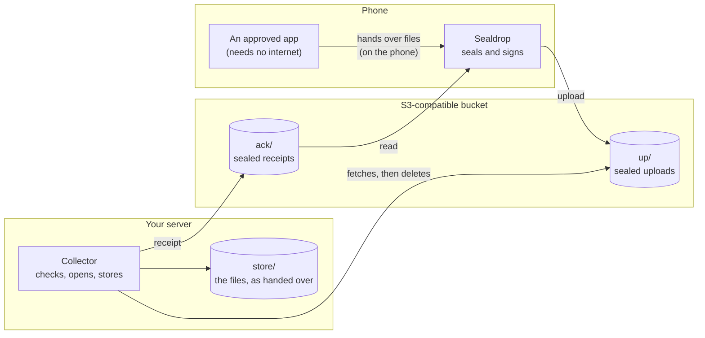

# Sealdrop

**A one-way drop box from apps on your Android phone to your own server at home, through a storage bucket that
can't read what it holds.**

> **Status: design stage.** The protocol is written down in [docs/PROTOCOL.md](docs/PROTOCOL.md) (a draft, second
> version); no code yet. Don't rely on it for anything.

## What it's for

- **Your data, your server:** you have an app on your phone whose data you want on your own server: a small machine
  at home, such as a Raspberry Pi. The app may have no internet permission at all.
- **Nothing reachable at home:** you don't want that server reachable from the internet. Sending shouldn't depend on
  your home connection or router either, or on the server being switched on right now.
- **Nothing readable in the cloud:** you're fine with a cloud bucket in between (any S3-compatible storage, e.g.
  Backblaze B2), as long as the provider can never read what's in it.

**What Sealdrop does:**
1. The app hands its files to Sealdrop on the phone.
2. Sealdrop seals them so that only your server can open them, signs them with a key it keeps in the phone's
   security chip, and drops them into the bucket.
3. Your server's collector checks the bucket every few minutes. It picks the files up, checks them, stores them and
   deletes them from the bucket.
4. The collector sends a receipt back the same way, so the phone knows the files are safe.

- **Sealed:** each upload has its own random key, and only the server's private key can unlock it (HPKE with X25519,
  ChaCha20-Poly1305).
- **Signed:** by a P-256 key that Sealdrop creates in the phone's security chip (Android StrongBox, or the TEE where
  there's none). The collector accepts nothing else.
- **Quiet on the outside:** random names, no metadata, one bundle per sync, rounded sizes.
- **Narrow keys:** the phone's storage keys can upload and read receipts. They can't read or list uploads, and they
  can't really delete them: they could hide one, but the collector still finds hidden files.
- **Paired once** with a QR code shown on the server.
- **Safe to repeat:** the collector stores first, then writes the receipt, then deletes the upload. The phone keeps
  its copies until the receipt arrives.

## The parts

| Part | What | State |
|---|---|---|
| [docs/PROTOCOL.md](docs/PROTOCOL.md) | the exact format and behaviour of both sides | draft |
| `android/` | the Sealdrop app (Android 17 or newer, Kotlin) | to come |
| `collector/` | the collector (Python 3, two dependencies: `cryptography`, and `segno` for the pairing QR code) | to come |
| `testvectors/` | made-up keys and sealed files that both sides must handle the same way | to come |

## How Sealdrop compares with existing projects

Sealdrop does one narrow thing. Several mature projects overlap with parts of it. If one of them fits your need, it's
probably the better choice: they have years of use and review behind them, and Sealdrop has none yet.

| Project | What it does | How Sealdrop differs |
|---|---|---|
| [rclone](https://rclone.org/) with its [crypt](https://rclone.org/crypt/) layer | A command-line tool that copies and syncs files to dozens of storage services. crypt encrypts contents (XSalsa20-Poly1305) and names, with keys from a password. | One password both writes and reads, so a phone that uploads could also read everything. The folder structure, modification times and file sizes (to within 16 bytes) stay visible. There are no sender signatures and no receipts, and Android support comes only through third-party apps. |
| [Syncthing](https://syncthing.net/) | Continuous two-way sync between your own devices, peer to peer. "Untrusted devices" ([beta](https://docs.syncthing.net/users/untrusted.html)) can keep encrypted copies. | The phone and the server must be online at the same time, unless a third, always-on device holds the copies (that's the beta feature, which still shows approximate file sizes). Sync also carries changes and deletions from the phone to the server, even one-way (only the discouraged `ignoreDelete` option stops them); Sealdrop only ever adds. The official Android app was discontinued in December 2024; community forks exist. |
| [Nextcloud](https://nextcloud.com/) | A self-hosted cloud suite (files, calendar, contacts and more) with mobile apps and automatic uploads. Optional [end-to-end encrypted folders](https://docs.nextcloud.com/server/stable/user_manual/en/files/using_e2ee.html). | The phone talks to your server directly, so the server must be reachable from wherever the phone is (open to the internet, a tunnel or a VPN). It's a web application with a database, which is a lot for a small machine. Its end-to-end encryption is per folder, works only on empty folders, and is read-only in the browser. |
| [Cryptomator](https://cryptomator.org/) | Encrypts a "vault" inside any cloud folder (Dropbox, WebDAV, S3 …). Desktop and mobile apps open it like a drive. | It's built for you to keep and open your own files, in both directions, and the password that writes also reads. The number of files and their approximate sizes are visible. There's no collector, no receipt and no proof of who wrote a file. |
| [restic](https://restic.net/), [Kopia](https://kopia.io/) | Encrypted, deduplicated backups with snapshots, to S3 and many other places. | They back up the machine they run on, with one password that reads and writes. They're a good companion: Sealdrop gets the files to your server, and a backup tool keeps the server's history. |
| [age](https://age-encryption.org/) | A simple file encryption tool and format (X25519, ChaCha20-Poly1305 in chunks). | A format and a command, not a delivery system: no signatures, no transport, no receipts. Sealdrop's sealed file is built the same way, with standard HPKE for the key and a signature added. |

**What Sealdrop does differently:**
- **Other apps hand it their files.** It has no storage permission, and it only accepts apps you approved, checked by
  their signing certificate on every call. The sending app itself needs no internet permission.
- **Store and forward through a bucket.** The phone sends from anywhere, whenever it has a network. The server
  collects whenever it's on. They never need to be online together, and nothing at home is reachable from outside.
- **The phone can seal but never open.** It holds only the server's public key, and its storage keys can't read or
  really delete uploads. Someone with the phone's keys can't open the uploads in the bucket; they could read its
  receipts (which deliveries arrived, and when).
- **Every upload is signed by the phone.** With a shared password, anyone who has it can make files that look
  genuine. Sealdrop's collector accepts only files signed by the paired phone's key, which Sealdrop creates in the
  security chip. (The collector can't check that yet; key attestation comes later.)
- **Receipts close the loop.** The phone learns that the server has stored each delivery (checked against
  checksums) before it lets go of its copies.
- **Less visible on the outside.** rclone crypt and Cryptomator keep one stored object per file, with its size
  visible to within a few bytes; restic and Kopia pack theirs. Sealdrop uploads one bundle per sync, with a random
  name and a rounded size.
- **Small at home.** The collector is a Python script with two small dependencies, about 30–50 MB of memory. There's no
  server, database or web interface to run or expose.

**What Sealdrop doesn't do:**
- no two-way sync, no browsing your files from the phone, no file sharing;
- no backups or history (pair it with a backup tool on the server);
- Android 17 or newer only, S3-compatible storage only, one server per phone, one owner;
- no outside security review or audit yet.

## Security in one paragraph

Everything in the bucket is sealed for its reader and signed by its writer: uploads for the server, receipts for the
phone. The storage provider sees how many uploads and receipts there are, their rounded sizes, when they arrive and
are picked up, the network address of every request (the phone's too, each time it checks for receipts) and which
storage key made it, but no names or contents. Each storage key can do exactly one job. The full list of
"who has what, and what can they do" is in [docs/PROTOCOL.md §14](docs/PROTOCOL.md#14-security-notes).

**The pairing QR code contains the phone's storage keys.** The `pair` command never writes it to a log or a file, and
it clears the screen afterwards. Your terminal's scrollback (or a session log) may still hold it, though, so close the
window after pairing ([§7](docs/PROTOCOL.md#keeping-the-qr-code-secret)).

## Licence

Apache License 2.0, see [LICENSE](LICENSE). Not affiliated with any of the projects or services named above.
