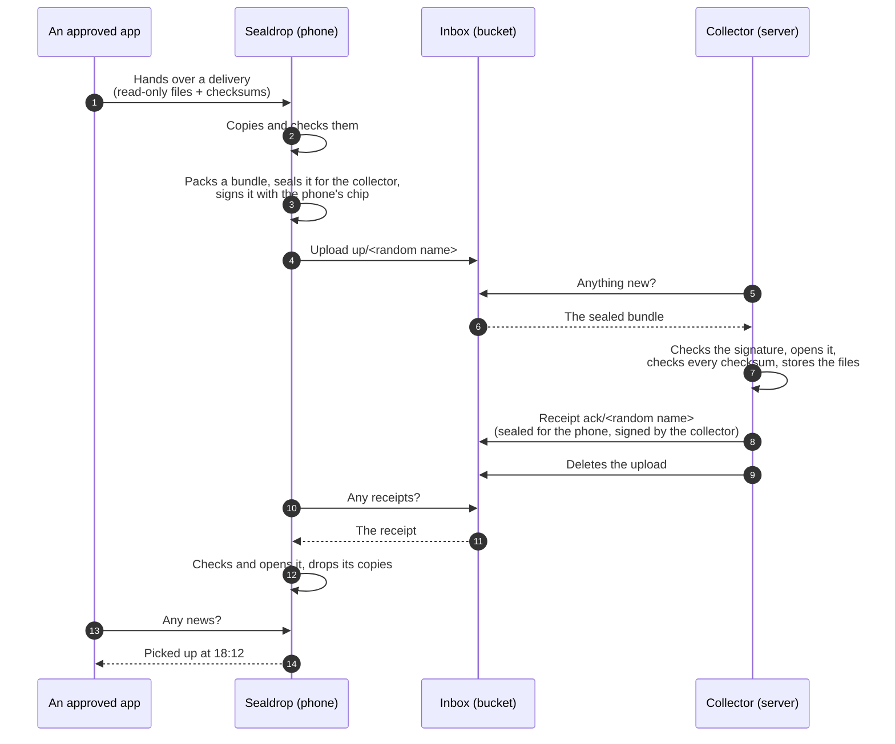

# Sealdrop protocol, version 1

**Status: draft (second version). Nothing is built yet.**

Sealdrop moves files from apps on an Android phone to your own server at home, through an S3-compatible bucket (the
"inbox"). The storage provider only ever holds sealed files: it can't read them, and it can't make the server accept a
file that didn't come from your phone. This document fixes every byte, so the two sides (the Android app and the
collector on the server) can be written and tested independently.

The parts:
- **Sender:** the Sealdrop app on the phone (Android 17 or newer).
- **Inbox:** a private bucket with two locations: `up/` for uploads from the phone, `ack/` for receipts from the
  server (§8).
- **Collector:** a small Python program on your server (for example a Raspberry Pi) that picks the files up.
- **Apps:** the apps on the phone that hand files to Sealdrop, each approved once by the owner.

---

## 0. In short



- **Sealed:** each upload gets its own random key. The content is encrypted with it, and the key itself is locked so
  that only the collector can unlock it.
- **Signed:** the phone signs every upload with a key that Sealdrop creates in its security chip, where it can't be
  copied out. The collector accepts nothing else.
- **Receipts the other way:** sealed for the phone and signed by the collector. Everything in the inbox is sealed for
  its reader and signed by its writer.
- **Nothing outside tells anything:** random names, no metadata, rounded sizes.
- **Pairing once,** with a QR code shown by the collector.
- **Every step can be repeated safely.** The collector stores first, then writes the receipt, then deletes the upload.
  The phone keeps its copies until the receipt.

---

## 1. Terms

| Term | Meaning |
|---|---|
| **Delivery** | A set of files from one app, with an ID chosen by the app. The ID must be unique for that app for ever, across phones, reinstalls and re-pairing: the collector files deliveries by app and ID only (`store/<app>/<delivery>/`), so a reused ID with other content becomes a conflict. An app that can't count reliably puts a random UUID (122 random bits) or more into the ID. Never changed once handed over. |
| **Bundle** | One upload: one or more whole deliveries, sealed together. |
| **Sealed file** | The encrypted, signed file format (§4). Three kinds: bundle, pairing request, receipt. |
| **Receipt** | A sealed file from the collector to one phone: what was stored, plus the collector's status (§6). |
| **Sender** | One install of Sealdrop on one phone. It has its own keys. A new phone or a reinstall is a new sender. |
| **Location** | Where uploads (`up`) or receipts (`ack`) go: an endpoint, region, bucket and prefix (§7, §8). |
| **Key ID** | SHA-256 of a public signing key in its encoding below (32 bytes). |

## 2. Keys

| Key | Algorithm | Private part lives | Public part known to |
|---|---|---|---|
| Collector opening key | X25519 | collector, plus the owner's password manager | sender (from the QR code) |
| Collector signing key | Ed25519 | collector, plus the owner's password manager | sender (from the QR code) |
| Sender signing key | ECDSA P-256 with SHA-256 | Android Keystore: StrongBox (the security chip) if the phone has one, otherwise the TEE. Can't be exported. | collector (from pairing) |
| Sender opening key | X25519 | Sealdrop's private storage, encrypted with a Keystore AES-256-GCM key (StrongBox if available) | collector (from pairing) |
| File key `K` | 32 random bytes | inside the sealed header of one file | nobody else |

- **Encodings:** X25519 and Ed25519 public keys as their raw 32 bytes; the P-256 public key as an uncompressed SEC1
  point (65 bytes: `0x04 ‖ X ‖ Y`).
- **The algorithm comes from the stored key, never from the file.** In version 1, senders always sign with P-256 and
  collectors always with Ed25519.
- **Why P-256 for the phone:** StrongBox (the security chip) only has to support P-256 among the signature curves;
  X25519 and Ed25519 aren't part of it. The chip also makes the random number each ECDSA signature needs.
- **Why the sender opening key is a software key:** Android's HPKE can't open with a Keystore key. So it's stored
  encrypted by a Keystore key and is only in memory while a receipt is opened.
- The Keystore keys' exact settings are in §9.4.

## 3. Building blocks

| Block | Choice |
|---|---|
| Sealing for a public key | **HPKE**, RFC 9180, mode base: DHKEM(X25519, HKDF-SHA256) `0x0020`, HKDF-SHA256 `0x0001`, ChaCha20-Poly1305 `0x0003`. One message per context ("single shot"): setup with the `info` of §4, then one seal with an empty `aad`. Output: `enc` (32 bytes) ‖ ciphertext. |
| Encrypting the content | **ChaCha20-Poly1305**, RFC 8439: 32-byte key, 12-byte nonce, 16-byte tag. |
| Deriving keys | **HKDF-SHA256**, RFC 5869. Sealdrop builds it on `Mac("HmacSHA256")` (about 15 lines) rather than rely on a platform class, and tests it with RFC 5869's SHA-256 test cases. |
| Signatures | **ECDSA P-256 with SHA-256** (FIPS 186-5), written as `r ‖ s`, each left-padded to 32 bytes, big-endian. Android produces DER, which is converted; about 1 signature in 128 has a shorter `r` or `s`. The phone writes the low-S form (if `s` > n/2, it writes n − `s`); readers accept both, and reject `r` or `s` equal to 0 or ≥ n. **Ed25519**, RFC 8032 (pure). |
| Checksums | SHA-256. |
| Random numbers | The platform's secure generator: `SecureRandom` on Android, `os.urandom` in Python. |
| Text | See below. |

**Text:**
- **JSON:** UTF-8 without a byte-order mark, I-JSON (RFC 7493). Readers reject duplicate names; numbers with a
  fraction or exponent; integers outside 0 … 2^53 − 1; NaN and infinities; unpaired surrogates, also as `\u`
  escapes; and nesting deeper than 8. `null` only where this document shows it; in `SenderInfo` it becomes 0.
- **base64url** (RFC 4648 §5) without padding, for keys and secrets. Readers reject padding, characters outside the
  alphabet, and unused bits that aren't zero.
- **Hex,** for IDs and checksums: lowercase only; readers reject capitals.
- **Base32,** only for the fingerprint: RFC 4648 §6, the alphabet `A–Z 2–7`, no padding.
- **Times:** integers, milliseconds since 1970-01-01 UTC.

Notes:
- Everything above is built into **Android 17** (`android.crypto.hpke`, Conscrypt; HKDF from HMAC) and into Python's
  **`cryptography`** package from version 47 on. No other crypto library is used.
- **ChaCha20 rather than AES:** many small servers (the Raspberry Pi 3 and 4, for example) have no AES instructions, and
  ChaCha20 is fast and timing-safe in plain software. Phones do both well.
- **Only the file key goes through HPKE:** Python's HPKE seals one message at a time and has no streaming. The content
  goes in 1 MiB pieces instead, so a large file never has to fit into memory. `age` is built the same way.

## 4. The sealed file

### Layout

| Offset | Size | Content |
|---|---|---|
| 0 | 32 | HPKE `enc`: the writer's one-time public key |
| 32 | 120 | the sealed header: the 104-byte header (below) plus its 16-byte tag |
| 152 | `L + 16·N` | the payload: `N` pieces, each piece 1 MiB of plaintext (the last one 1 byte to 1 MiB) plus a 16-byte tag |
| `152 + L + 16·N` | 64 | the signature |

- `L` is the padded payload length (below) and `N = ceil(L / 1 MiB)`; `L` is never 0, so `N ≥ 1`.
- **The file's size is therefore `152 + L + 16·N + 64`, exactly.** A reader computes it from the header and rejects
  any other size.
- Nothing in the file is readable without the opening key: no magic bytes, no version in the clear. To anyone else
  it looks like random bytes.

### The header (104 bytes, big-endian)

| Offset | Size | Field |
|---|---|---|
| 0 | 1 | format version: `1` |
| 1 | 1 | kind: `1` bundle, `2` pairing request, `3` receipt |
| 2 | 2 | reserved: `0` |
| 4 | 4 | piece size: `1048576` |
| 8 | 8 | created: milliseconds since 1970 (UTC), the writer's clock. Only shown, never trusted. |
| 16 | 8 | content length `n` in bytes |
| 24 | 16 | message ID: random |
| 40 | 32 | writer's key ID: SHA-256 of the writer's signing public key |
| 72 | 32 | file key `K`: random |

The header is sealed with HPKE for the reader's opening key, with an empty `aad` and an `info` (ASCII) for the
direction: `sealdrop/v1/header/to-collector` for kinds 1 and 2, `sealdrop/v1/header/to-sender` for kind 3. Readers
reject a version other than 1, a kind they don't expect (the collector: 1 and 2; the phone: 3), a reserved field
other than 0 and a piece size other than 1048576.

### The payload

- **Payload key:** `PK = HKDF-SHA256(IKM = K, salt = message ID, info = "sealdrop/v1/payload", length = 32)`.
- **Plaintext:** the content (`n` bytes, §5) followed by zero bytes up to `L`.
- **Pieces:** the plaintext is cut into 1 MiB pieces. Piece `i` (counting from 0) is sealed with ChaCha20-Poly1305
  under `PK`, an empty `aad`, and the nonce `i` as an 11-byte big-endian number followed by one flag byte: `0x01` for
  the last piece, `0x00` for every other one.
- Numbered pieces with a marked last one mean that a changed, missing, swapped or cut-off piece fails to decrypt.
- **The padding must be all zeros.** A reader checks it.

### Padded length `L` (rounded sizes)

| Kind | Rule |
|---|---|
| 1, bundle | `n` up to 4 MiB: rounded up to the next multiple of 256 KiB (at least 256 KiB). Above 4 MiB: rounded up to the next multiple of 4 MiB. |
| 2, pairing request | always 256 KiB (`L` = 262,144), the size of the smallest bundle; `n` at most 256 KiB |
| 3, receipt | rounded up to the next multiple of 4 KiB (at least 4 KiB); `n` at most 256 KiB |

- **Examples:**
  - a bundle with 300,000 bytes of content: `L = 524,288` and `N = 1`, so the file has 524,520 bytes;
  - a pairing request, and the smallest bundle: 262,376 bytes;
  - a receipt with 900 bytes of content: `L = 4,096`, so the file has 4,328 bytes.
- **Possible sizes:** in `up/` about 1,040 sizes up to 4 GiB are possible, in `ack/` 64. Readers check a listed size
  before downloading (§6, §10).
- Receipts get the small rounding because the phone reads them over mobile data too, and their size says nothing the
  number of uploads doesn't already show. A pairing request looks like a small bundle.

### The signature (the last 64 bytes)

- **Statement:** the ASCII text `sealdrop/v1/sig/sender` (written by a phone, kinds 1 and 2) or
  `sealdrop/v1/sig/collector` (kind 3), then one `0x00` byte, then the SHA-256 of every byte of the file before the
  signature.
- The phone signs the statement with ECDSA P-256/SHA-256; the collector signs it with Ed25519.
- Different texts for the two roles mean a signature from one role can never pass as the other's.

### Reading a sealed file, in this order

1. The size is possible (`152 + L + 16·N + 64` for an `L` the table allows for the kinds expected there) and within
   the reader's limit (§12).
2. Open the header with your opening key; a collector also tries its retired opening keys (§7, re-pairing). If it fails:
   reject.
3. Check the header fields, compute `L` and `N`, and check the file's size exactly.
4. Find the writer by its key ID: a paired sender for kind 1, the paired collector for kind 3. **Kind 2** is read
   only by the `pair` command while a pairing is waiting (a regular run rejects it here). It decrypts the payload
   first (`n` is at most 256 KiB), reads only `sender_sign` from the manifest, and checks that its SHA-256 equals the
   header's key ID; that key is the writer for step 5. An unknown writer: reject.
5. Hash everything before the signature and check the signature with the stored key. If it fails: reject.
6. Only now decrypt the pieces, one at a time, and check the padding.
7. Read the content (§5).

Opening the 120-byte header before the signature check is safe: it's a normal HPKE decryption, and nothing from the
content is used before the signature has been checked. For kind 2 the payload is decrypted before the signature check
too. It's at most 256 KiB, and nothing in it except `sender_sign` is used until the signature and the `mac` have been
checked.

## 5. The content

```
content = manifest length m (4 bytes, big-endian) ‖ manifest (m bytes, UTF-8 JSON) ‖ the files' bytes, one after another
```

- The files follow in the order the manifest lists them, with nothing in between.
- So `n = 4 + m + the sum of all file sizes`. A bundle's manifest is at most 4 MiB.
- Pairing requests and receipts carry only a manifest, no files.

### Bundle manifest (kind 1)

```json
{
  "v": 1,
  "type": "bundle",
  "deliveries": [
    {
      "app": "org.example.tracker",
      "delivery": "a1b2c3d4-000042",
      "created": 1789285265000,
      "files": [
        { "path": "manifest.json", "size": 1532, "sha256": "5d41…" },
        { "path": "data/2026-09-13.json.gz", "size": 268114, "sha256": "4be1…" },
        { "path": "photos/9f2b….jpg", "size": 812345, "sha256": "9f2b…" }
      ]
    }
  ]
}
```

*(Made-up example; checksums shortened with "…", real ones have 64 hex characters.)*

**Fields and names:**
- **`app`:** the sending app's package name, as Android reports it for the caller (never what the app claims). At most
  100 characters.
- **`created`:** Sealdrop's clock at `commit`.
- **`delivery`:** 1 to 100 characters from `A–Z a–z 0–9 . _ -`, starting with a letter or digit, following the part
  rules below; unique for its app for ever (§1).
- **`path`:**
  - 1 to 8 parts separated by `/`, at most 255 bytes including the `/`;
  - each part 1 to 128 characters from `A–Z a–z 0–9 . _ -`, starting with a letter or digit and not ending with `.`;
  - no part is, before its first `.` and ignoring case, `CON`, `PRN`, `AUX`, `NUL`, `COM0`–`COM9` or `LPT0`–`LPT9`
    (Windows can't store them);
  - so no `..`, no hidden files and no absolute paths;
  - paths are compared after ASCII case folding (`A–Z` to `a–z` and nothing else, never a language's lower-casing):
    no two are equal, and none begins with another followed by `/` (a file can't also be a folder).
- **A delivery has 1 to 10,000 files.**

**Delivery digest:** SHA-256 over this UTF-8 text: for every file, sorted by `path` (byte order), the path, a line
break, the size in decimal, a line break, the hex checksum and a line break. Sender and collector both compute it;
receipts quote it (§6).

### Reading rules
- Unknown fields are ignored, so later versions can add optional ones.
- **Two levels of failure:**
  - **The whole file** is rejected only for an envelope failure: its size, the header, the signature, a piece's tag,
    the padding, or a manifest that can't be read (not valid under §3's rules, an unknown `v` or `type`, more than
    1,000 deliveries or 10,000 files, or file sizes that don't add up to `n`).
  - **Everything else is decided per delivery:** names (above), limits, and each file's size and checksum. A delivery
    that fails is rejected alone (`"result": "rejected"` with a `reason`, §6); the bundle's other deliveries are
    stored as usual. The collector still reads through the rejected delivery's bytes, so every piece is checked.

## 6. Receipts (kind 3)

A receipt is written by the collector for **one** sender: sealed for that sender's opening key, signed with the
collector's signing key, and uploaded to `ack/<random name>`.

```json
{
  "v": 1,
  "type": "receipt",
  "for": "<the sender's key ID, hex>",
  "time": 1789285999000,
  "stored": [
    {
      "message": "<message ID, hex>",
      "sealed_sha256": "<SHA-256 of the whole sealed file as uploaded, hex>",
      "received": 1789285900000,
      "deliveries": [
        { "app": "org.example.tracker", "delivery": "a1b2c3d4-000042", "digest": "<hex>", "result": "stored" },
        { "app": "org.example.tracker", "delivery": "a1b2c3d4-000043", "digest": "<hex>", "result": "rejected",
          "reason": "bad-file" }
      ]
    }
  ],
  "rejected": [
    { "sealed_sha256": "<hex>", "size": 262376, "reason": "bad-signature", "at": 1789285000000 }
  ],
  "status": {
    "collector": "1.0.0",
    "instance": "<16 bytes, hex>",
    "last_pickup": 1789285900000,
    "last_backup": null,
    "free_bytes": 201234567890,
    "rejected_7d": 0,
    "rejected_more": 0,
    "vanished_7d": 0
  }
}
```

- **`result`:**
  - `stored`: new and stored;
  - `duplicate`: already stored with the same digest (a repeated upload);
  - `conflict`: the same app and delivery ID is already stored with other content. The new content is kept in
    `conflicts/<app>/<delivery>/<digest>/`, never overwritten, and the owner is warned once. The same conflicting
    content arriving again is reported as `conflict` again, with no new copy and no new warning.
  - `rejected`: this delivery broke a rule, and nothing of it is stored. `reason`: `bad-name`, `bad-file` (a size or
    checksum doesn't match) or `too-many-files`.
- **`rejected`:** whole uploads rejected since the last receipt, with a short reason (`bad-signature`,
  `unknown-sender`, `damaged`, `bad-content`, `too-big`). The collector can't tell who sent a rejected file, so every
  paired sender is told.
- **Size:** a receipt's content is at most 256 KiB.
  - `rejected` holds at most 100 entries, newest first; any more are counted in `rejected_more` (0 if none).
  - If `stored` doesn't fit, the collector writes several receipts in the same run. An entry too big for one receipt
    is split by deliveries; each part repeats `message`, `sealed_sha256` and `received`.
  - The upload is deleted only after all of its receipts are uploaded (§10, step 8).
- **`status`:**
  - `instance`: the collector's instance ID (§10);
  - `last_backup`: from the server's backup job, if there is one (§10); otherwise `null`;
  - `rejected_7d` and `vanished_7d`: counts over the last 7 days (§10).
- **Status receipt:** at the end of a run, the collector writes a receipt with an empty `stored` for each sender that
  got no receipt in the last 24 hours. So the phone can show the server's state even when nothing was sent.
- **Paired receipt:** the answer to a pairing request (§7).

**The phone with a receipt:**
1. It lists `ack/` and fetches every name it hasn't handled yet. A name whose listed size isn't possible for kind 3
   (§4) is skipped without downloading.
2. It reads it as in §4 (the writer must be the paired collector, and `for` must be its own key ID).
3. A receipt it can't open is meant for another phone, or is junk. It's ignored, and its name is remembered so it isn't
   fetched again. If none opens for 3 days, the phone warns (§9.3).
4. **Matching:** each entry is matched by (`app`, `delivery`, `digest`), whatever its message ID:
   - `stored` or `duplicate`: "picked up" at `received` (the earliest, if there are several); the copies are dropped.
   - `conflict`: the collector keeps this content apart (§10). The copies are dropped, and the app sees state 5.
   - `rejected`: see step 5.
   - The same app and delivery with another digest: a warning, never a confirmation.
5. **Rejected uploads:** Sealdrop keeps the SHA-256 of every sealed file it uploaded until its receipt.
   - For an entry in `rejected` that matches one of its uploads, and for every delivery with the result `rejected`,
     it checks its copies against the checksums the app gave. A copy that fails is dropped and reported as unknown
     (state 0), so the app hands it over again (§9.1). The others are sent again at once, each delivery in a bundle
     of its own.
   - A delivery rejected twice gets state 6 (failed): it isn't sent again, and Sealdrop and the app warn.
6. **Replays and two collectors:**
   - The phone takes `status` only from the receipt with the newest `time`, and counts each `rejected` entry once
     (by `sealed_sha256`). The provider can replay old receipts; they change nothing.
   - It compares the `instance` of its receipts in the order of their `time`, ignoring any receipt older than the
     newest it has seen. Two instance IDs alternating (A, B, A) within 7 days, or `vanished_7d` above 0: the warning
     "two collectors". A single change from A to B is a move, with no warning.
7. Receipts disappear from `ack/` through the bucket's lifecycle rule (30 days); the phone forgets names that are gone
   from the listing.

## 7. Pairing

### The QR code (shown by the collector)

The owner runs the collector's `pair` command in their own terminal. It asks for the phone's two storage keys (pasted
from the password manager; the collector doesn't keep them) and shows a QR code, valid once and for 10 minutes, with
this UTF-8 JSON:

```json
{
  "sealdrop": 1,
  "type": "pair-offer",
  "pairing": "<16 random bytes, base64url>",
  "expires": 1789286400000,
  "storage": {
    "up":  { "endpoint": "https://s3.<region>.backblazeb2.com", "region": "<region>", "bucket": "<bucket name>",
             "prefix": "up/", "key": { "id": "<key ID>", "secret": "<key>" } },
    "ack": { "prefix": "ack/", "key": { "id": "<key ID>", "secret": "<key>" } }
  },
  "collector_open": "<32 bytes, base64url>",
  "collector_sign": "<32 bytes, base64url>",
  "code": "<16 random bytes, base64url>"
}
```

- **The locations:** `up` holds the upload key, `ack` the receipts key. `ack` may leave out `endpoint`, `region` and
  `bucket`; they're then the same as in `up`. A `prefix` is empty (a bucket of its own) or ends with `/`.
- **Size:** about 600 bytes (594 with real-length keys). It's drawn at error correction level L (85 × 85 modules)
  with half-block characters, so it needs modules + 8 columns and half as many rows: 93 × 47. The `pair` command
  checks the terminal's size first.

### Keeping the QR code secret

The QR code holds the phone's two storage keys and the one-time code, so it's treated as a secret.

- **Keys at a prompt:** the storage keys are pasted at a prompt that doesn't show them, never given as command-line
  arguments, so they can't end up in the shell history or the process list.
- **Memory only:** the `pair` command keeps the keys, the code and the QR code's content in memory. Nothing of it is
  ever written to the log, to `state/` or anywhere else on disk. The log only notes that a pairing started and how it
  ended, with the fingerprint.
- **Only on a terminal:** it refuses to show the QR code when its output goes to a file or a pipe.
- **Cleared afterwards:** as soon as a valid request arrives, and when the pairing is cancelled (Ctrl+C) or expires
  after 10 minutes, it clears the screen and asks the terminal to clear its scrollback as well (`ESC [3J`).
- **The terminal may still keep it.** Some terminals ignore that request, and session logging (in PuTTY, tmux or
  screen, for example) would have recorded the QR code. So pair from a terminal without session logging, and close
  the window afterwards. When `$TMUX` or `$STY` is set, the command warns before showing the QR code: tmux and
  screen keep their own history, which `ESC [3J` doesn't clear.
- **After the 10 minutes,** the code is useless, but the storage keys stay valid. If the QR code may have been seen or
  recorded, replace the phone's two storage keys and pair again.
- **On the phone,** Sealdrop keeps no camera image and never logs the scanned text. It stores the storage keys
  encrypted (§9.4) and forgets the code once pairing is over.

### What the phone does

1. It checks the offer: `sealdrop` is 1, the type, not expired (with 5 minutes' allowance for a wrong clock), and the
   endpoints are `https`.
2. It creates its signing key (P-256, in StrongBox if the phone has it) and its opening key (X25519, stored encrypted).
3. It shows the **fingerprint** (below).
4. It sends a **pairing request**: a sealed file of kind 2, signed with the new key, uploaded with the upload key.
   Its manifest:

```json
{
  "v": 1,
  "type": "pair",
  "pairing": "<as in the offer>",
  "sender_sign": "<65 bytes, base64url>",
  "sender_open": "<32 bytes, base64url>",
  "label": "Phone",
  "replaces": "<the old key ID, hex; only when pairing again>",
  "mac": "<32 bytes, base64url>"
}
```

   - **`label`:** a name the owner can change, to tell phones apart on the collector: 1 to 40 characters (code
     points), with no control, format or bidi characters (Unicode categories Cc, Cf, Zl and Zp). The collector
     checks it before printing it.
   - **`replaces`:** only when this phone pairs again (below).
   - **`mac`:** `HMAC-SHA256(key, transcript)`, where:
     - `key = HKDF-SHA256(IKM = code, salt = pairing, info = "sealdrop/v1/pair-mac", length = 32)`;
     - `transcript` = the ASCII text `sealdrop/v1/pair` ‖ pairing (16 bytes) ‖ collector_open (32) ‖ collector_sign
       (32) ‖ sender_sign (65) ‖ sender_open (32) ‖ replaces (32, or 32 zero bytes when there's none).
   - The header's writer key ID is the SHA-256 of `sender_sign`.
5. It waits for the **paired receipt**: it checks `ack/` every 30 seconds while the pairing screen is open, and in
   the background until `expires` plus 10 minutes.

### What the collector does

The `pair` command does the waiting itself. It holds the collector's lock for up to 10 minutes (regular runs skip
meanwhile) and checks `up/` every 10 seconds. It handles only kind 2; everything else is left for the regular runs. A
pairing request that a regular run finds is rejected. A pairing request is accepted only if everything holds:
- there's a waiting pairing with this `pairing`, not expired and not used;
- the header's key ID is the SHA-256 of `sender_sign`;
- the signature checks out with `sender_sign`;
- the `mac` is right (compared in constant time).

Then the collector:
1. stores the sender (key ID, both public keys, label, time) and marks the pairing as used;
2. clears the QR code and shows the fingerprint;
3. writes a **paired receipt** (kind 3, sealed for `sender_open`):
   `{"v": 1, "type": "paired", "for": "<key ID, hex>", "pairing": "…", "time": …}`;
4. deletes the request from `up/`;
5. if the request has `replaces`, offers to retire that old sender, and does it only after the owner confirms.

A request that fails any check is rejected like any other file. The pairing stays open until it expires, so junk
can't use it up: only a request made with the code can.

### The fingerprint

`SHA-256("sealdrop/v1/fingerprint" ‖ pairing ‖ collector_open ‖ collector_sign ‖ sender_sign ‖ sender_open)`, the
first 10 bytes in base32 (§3), shown as four groups of four: `K7Q2 M3XD 4HTB WPLA`. Both screens show it, and the
owner compares them. If they differ, someone else used the QR code first: replace the phone's two storage keys,
unpair the stranger on the collector, and pair again.

### Unpairing and re-pairing

- **`unpair <fingerprint or label>`** on the collector removes a sender; its files are rejected from then on. The
  phone's storage keys are removed separately, in the storage provider's console (the collector has no right to).
- **Pairing again on the same phone** (new storage keys, a new collector key, or after a fingerprint mismatch):
  Sealdrop makes new keys and adds `"replaces": "<the old key ID, hex>"` to the pairing request. It keeps its old
  opening key and reads receipts with both until everything sent under the old keys is confirmed or resealed. Right
  after the paired receipt, it reseals every unconfirmed delivery (new message IDs, new names). The `pair` command,
  seeing `replaces`, offers to retire the old sender, and does it only after the owner confirms. Until then, uploads
  signed with the old key are still accepted, so nothing in the inbox is lost.
- **A new collector opening key:** the collector keeps its old opening keys as retired keys, so files sealed for them
  can still be opened. The phone reseals every unconfirmed delivery for the new key after pairing again.

## 8. The inbox and its requests

- **The bucket (or buckets):** private, the provider's own encryption switched on (an extra layer only), no object
  lock.
- **Locations:** `up` (phone → collector) and `ack` (collector → phone), each an endpoint, region, bucket and prefix
  (§7). Wherever this document says `up/` or `ack/`, it means that location's prefix.
- **Names:** the location's prefix plus 32 characters from `a–z 2–7` (160 random bits). Nothing else is ever in a
  name, and the phone never reuses one.
- **What a provider must allow** (the setup script checks it): the phone's upload key can write into `up` but can't
  read, list or permanently delete there; the receipts key can only list and read `ack`; the collector's keys are
  limited the same way (table below); and both locations have an expiry rule. With Backblaze B2 that's one bucket
  with two prefixes. A provider that can limit a key to a whole bucket, but not to a prefix, uses two buckets with
  empty prefixes.
- **Without versioning:** the collector lists with `ListObjectsV2` and deletes by name, and the phone never reuses a
  name. An upload key can then overwrite a waiting upload, which is a real delete; the phone's re-send after 60 days
  is the only safety net (§14).
- **A spending cap** at the provider, if it has one, limits what a junk flood can cost.
- **Every request:**
  - HTTPS (TLS 1.2 or newer) with the system's certificate authorities only, never user-added ones;
  - path style: `https://<endpoint host>/<bucket>/<name>`, so the bucket name travels inside the encrypted connection;
  - AWS Signature Version 4 (service `s3`, the region from pairing), with `x-amz-content-sha256` set to the body's
    SHA-256 (a signed body, also for empty bodies);
  - `User-Agent: sealdrop`, on both sides (the collector sets it too, so its Python version isn't sent), nothing
    about the device;
  - uploads with `Content-Type: application/octet-stream`;
  - no metadata headers, tags, content disposition or other optional headers;
  - redirects are not followed.

| Who | Request | Key (permissions) |
|---|---|---|
| phone | `PutObject up/<name>`, for files up to 8 MiB | upload key (write, `up` only) |
| phone | `CreateMultipartUpload`, `UploadPart` (8 MiB parts, the last smaller), `CompleteMultipartUpload`, `AbortMultipartUpload` | upload key |
| phone | `ListObjectsV2` with the `ack` prefix; `GetObject ack/<name>` | receipts key (list + read, `ack` only) |
| collector | `ListObjectVersions` with the `up` prefix (sees hidden versions too) | pickup key (list + read + delete, `up` only) |
| collector | `GetObject up/<name>?versionId=…`, with `Range` to resume | pickup key |
| collector | delete each handled version by its version ID: `DeleteObject …?versionId=…` | pickup key |
| collector | `PutObject ack/<name>` | receipts key (write, `ack` only) |

- **Resuming:** the phone stores the upload ID and the parts' ETags, so it never needs to list (its key can't). If
  the provider no longer knows the upload (`NoSuchUpload`, e.g. after the lifecycle rule cancelled it), it starts over.
- **Retries:**
  - network errors, timeouts, `5xx` and `429`: retried with growing pauses (30 s, then 1, 2, 5 and 15 minutes, then
    hourly), honouring `Retry-After`. Each pause varies by ±20 % at random; the steps count per sync run.
  - `401` and `403`: no quick retries. The phone shows "storage key refused", or "storage cap reached" when the
    provider says so, and tries again once a day and at the next sync run.
  - a clock error (`RequestTimeTooSkewed`): "the phone's clock is wrong".
- **Timeouts:** 15 s to connect, 60 s without data.

## 9. The sender (Sealdrop on Android)

### 9.1 Handing over files (between apps on the phone)

Apps talk to Sealdrop through a bound service with an AIDL interface (action `app.sealdrop.action.DELIVER`, package
`app.sealdrop`). Nothing goes through shared storage.

```aidl
interface ISealdrop {
    int apiVersion();                                   // 1
    BeginResult begin(String delivery, int network);    // network: 1 = may use mobile data, 2 = Wi-Fi only
    int add(String handle, in FileOffer[] files);       // up to 100 files and 1 GiB per call; one larger file alone
    int commit(String handle);                          // checks everything, then queues the delivery
    oneway void abort(String handle);
    oneway void hold(int seconds);                      // the caller's hold, 1 to 900 seconds
    oneway void release();                              // ends the caller's own hold only
    DeliveryState[] status(in String[] deliveries);     // the caller's own deliveries only
    SenderInfo info();
    int sendNow(boolean allowMobileForWifiOnly);        // the caller's own deliveries only
}
parcelable BeginResult { int code; String handle; }    // handle is set only when code is 0
parcelable FileOffer { String path; long size; String sha256; ParcelFileDescriptor file; }
parcelable DeliveryState { String delivery; int state; long time; }
// state: 0 unknown, 1 queued, 2 uploading, 3 in the inbox, 4 picked up (time = received),
//        5 conflict (time = received), 6 failed (rejected twice, §6)
parcelable SenderInfo { boolean paired; String fingerprint; long lastPickup; long lastBackup;
                        int waiting; long oldestWaiting; int warnings; }
// waiting and oldestWaiting count the caller's own deliveries.
// warnings, bit 0 first: waiting over 2 days, storage key refused, clock wrong, the collector rejected files,
//   not paired (also: a key is missing, pair again), two collectors, sending held for over 24 hours,
//   a delivery failed, storage cap reached, can't read receipts
```

- **Who may call:**
  - Sealdrop takes the caller from Android (`Binder.getCallingUid()`), never from the request. `app` is the only
    package of that UID (`PackageManager.getPackagesForUid`); a UID with more than one package is refused.
  - It accepts only apps the owner approved, by package name and the SHA-256 of their signing certificate, checked on
    every call with `PackageManager.hasSigningCertificate(uid, cert, CERT_INPUT_SHA256)`.
  - Every method except `apiVersion()` checks the caller first. An unapproved caller gets `2` (in `BeginResult` too),
    an empty `status()`, a null `info()`, and its `hold()` and `release()` are ignored. Sealdrop shows the request
    once, so the owner can approve it after comparing the certificate.
- **Handles:**
  - `begin` with a delivery ID that has an unfinished handle aborts the old one. For an ID that is already
    committed, `commit` decides: the same digest gives `1`, another digest `9`, and the new copy is dropped.
  - Handles end with Sealdrop's process; a later call with one gets `10`.
  - At most two `add` calls copy at the same time; a third gets `8`.
- **Files, not paths:** the app opens each file read-only and passes the open file. Sealdrop can read exactly those
  files and nothing else; it has no storage permission.
  - Sealdrop accepts only a regular file (`fstat`, `S_ISREG`) whose size equals `size`, before and after the copy. It
    reads with positional reads from offset 0, because the file offset is shared with the app.
  - A read that stalls for 60 seconds ends the call with `8`.
  - Every descriptor received is closed, also on errors.
- **During `add`,** Sealdrop copies each file into its private storage and checks its size and checksum. `commit`
  answers only once everything is copied and checked.
- **Results:**
  - `0` OK;
  - `1` already have it (same delivery, same digest);
  - `2` not approved;
  - `3` not paired;
  - `4` bad request (names, sizes, limits);
  - `5` checksum wrong;
  - `6` not enough space;
  - `7` too big;
  - `8` busy, try later;
  - `9` conflict: the same delivery ID with other content;
  - `10` unknown handle (aborted, or Sealdrop was restarted): begin again.
- **Apps call from a background thread**, never from a thread that matters (such as a recording). A hanging Sealdrop
  can only hang that one thread.
- **Hold:** holds are per app. Sealdrop sends and fetches nothing while any app holds, and `release()` ends only the
  caller's own hold. A running upload stops after the current part (a single upload is cancelled and repeated later).
  Each hold ends by `release()` or when its time runs out, so a crashed app can't block sending for long. Sealdrop's
  screen shows which app holds and since when, and warns when sending has been held for more than 24 hours in a row.
- **An app keeps its own copy** until `status()` says "picked up" or "conflict". If Sealdrop says "unknown" (it lost
  the delivery, e.g. after a reinstall), the app hands it over again.
- **`status()`** remembers picked-up deliveries for at least 1 year; apps stop asking once one is picked up.

### 9.2 Bundling and sending

- **When:** a sync run starts 30 seconds after the last `commit` (so files handed over one after another travel
  together), when an allowed network comes back, on `sendNow`, and on the retry timer. Never during a hold.
- **Which network:**
  - On Wi-Fi without a metered flag: everything.
  - On mobile data, a phone hotspot or metered Wi-Fi: only deliveries marked "may use mobile data", up to **10 MiB of
    sealed files per run**. That counts sealed bytes, padding included, so at most 8 MiB of content goes over mobile
    data per run (8 MiB and 1 byte would be padded to 12 MiB). The rest waits for Wi-Fi.
  - Never while roaming. With Android's Data Saver on, only on Wi-Fi.
  - The owner's setting "Wi-Fi only" sends everything on Wi-Fi only.
  - `sendNow(true)` lets the caller's own Wi-Fi-only deliveries use mobile data. The calling app asks the owner first.
- **Packing:** the oldest waiting deliveries that the network allows go into one bundle, until the next would push it
  over a limit: 10 MiB on mobile data, 256 MiB of content on Wi-Fi, 1,000 deliveries, 10,000 files, a 4 MiB
  manifest. A single delivery that is bigger travels alone, on Wi-Fi, up to the collector's limit.
- **Sealing and uploading:**
  - The bundle is sealed into a temporary file at upload time, and kept until the upload is complete, so it can
    resume.
  - Up to 8 MiB it goes in one request; above that, in 8 MiB parts.
  - A resealed bundle always gets a new name.
- **After the upload:** the deliveries are "in the inbox", and Sealdrop looks for the receipt.
- **No receipt after 60 days:** sealed again (a new message ID) and uploaded again, and again every 60 days, packed by
  the normal rules. The collector recognises deliveries it already has (§10).
- **The first run after a hold ends** is started as an expedited job, so Android's power saving doesn't delay it.

### 9.3 Receipts and warnings

- **When:** every 15 minutes while anything is "in the inbox"; after 24 hours without a new receipt, hourly; after 3
  days, every 6 hours; back to 15 minutes after the next upload. Otherwise once a day, plus right after `sendNow`.
  Never during a hold. Receipts are small, so they're fetched on mobile data too (unless the owner chose "Wi-Fi
  only").
- **Warnings** (in `SenderInfo`):
  - a delivery has waited in the inbox for more than 2 days;
  - the storage refused a key, or its spending cap is reached;
  - the phone's clock is wrong;
  - the collector reported rejected files, or a delivery failed (§6);
  - not paired, or a key is missing (pair again, §9.4);
  - two collectors (§6);
  - sending has been held for more than 24 hours;
  - can't read receipts: `ack/` had new receipts, but none of them opened for 3 days. The collector writes every
    sender at least one receipt a day, so this means something is wrong on the phone.

### 9.4 What Sealdrop keeps on the phone

- **Where:** everything in its private, credential-encrypted storage, so after a restart it does nothing until the
  first unlock. Android's cloud backup and device transfer are switched off for it (`allowBackup="false"`, data
  extraction rules), so its keys and copies never leave the phone that way.
- **Keys:** the storage keys from the QR code and the private opening key are stored encrypted with a Keystore key
  (StrongBox if available). The signing key never leaves the Keystore.
- **The Keystore keys, exactly:**
  - Signing key: purpose sign, `ECGenParameterSpec("secp256r1")`, digest SHA-256, `setIsStrongBoxBacked(true)`; on
    `StrongBoxUnavailableException`, made again without it (the TEE).
  - Wrapping key: AES, 256 bits, purpose encrypt and decrypt, GCM, no padding, random IVs (the default), StrongBox
    as above.
  - Both: no user authentication, no `setUnlockedDeviceRequired`, no user-presence requirement, no validity end. So
    they work while the phone is locked in a pocket, and a new screen lock or fingerprint doesn't invalidate them.
  - If either key is missing or unusable (`KeyPermanentlyInvalidatedException`, a cleared Keystore): Sealdrop stops
    sending, keeps every copy, and warns "pair again". After pairing again it reseals the copies (§7).
- **Copies:** a delivery's copy is deleted once a receipt says it's stored, a duplicate or a conflict, and when the
  owner unpairs. The SHA-256 of every sealed upload is kept until its receipt (§6).
- **Logs** (logcat, which ends up in bug reports): only message IDs, sizes, result codes and reasons; never app
  names, delivery IDs, paths or keys. Release builds log only errors.

### 9.5 Network rules

- **One place opens connections,** and only to the hosts from pairing. It checks the host before every connection.
- **Unencrypted connections** are refused (network security config); no proxy is used unless the system sets one.
- **Permissions:** `INTERNET`, `ACCESS_NETWORK_STATE`, `CAMERA` (for the QR code, granted "only this time"), and what
  the job scheduler and notifications need. No storage, location or contacts permission.

## 10. The collector

A Python 3 program with two packages: `cryptography`, and `segno` (pure Python) to draw the pairing QR code.

**Runs:** every 10 minutes; only one at a time (a lock file). While the `pair` command waits, it holds the lock (§7).
A run starts only when the system clock is synchronized (`timedatectl show -p NTPSynchronized` says `yes`). Small
boards such as the Raspberry Pi have no clock of their own, and until it's set, signed requests fail and times would
be wrong.

### The folders (the data root, e.g. `/srv/sealdrop`)

```
config/      collector settings: the two locations, the collector's two storage keys (readable by the collector only)
keys/        the collector's opening and signing keys; retired/ holds old opening keys
senders/     one file per paired sender: key ID, both public keys, label, when it was paired
state/       what was handled (message IDs, sealed checksums, results, the digest of every stored delivery),
             receipts still to write, status.json, instance, and last-backup (written by a backup job, if any)
incoming/    downloads, named by the SHA-256 of the name and version ID
store/       THE RESULT: store/<app>/<delivery>/<path>
conflicts/   deliveries whose ID was already stored with other content: conflicts/<app>/<delivery>/<digest>/
rejected/    rejected sealed files, each with a reason file; at most 1 GiB in all, the oldest go first
log/         the collector's log (rotated)
```

- **Never in any of these folders, nor in the log:** the QR code's content, the one-time code, the phone's storage
  keys, or any file content.
- **The log** may hold message IDs, sizes, results, reasons, app names, delivery IDs, labels and fingerprints (app
  names and delivery IDs are folder names in `store/` anyway), never paths, keys or content.
- **Instance:** the first time a data root is used, the collector makes 16 random bytes, its instance ID, and keeps
  them in `state/instance` with the SHA-256 of `/etc/machine-id`. If that checksum doesn't match at start, it makes a
  new instance ID. So restoring the data root from a backup onto a new machine (or onto a fresh system on the same
  machine) is a new instance, and so is moving the disk to another machine; a restart isn't. Receipts carry it (§6),
  so the phone notices two collectors on one inbox.

### Handling one upload, in this order

0. **At the start of a run:** empty `store/.tmp/`; keep a download in `incoming/` only for the same name and version
   ID.
1. **List:** every page of `ListObjectVersions` on `up/`, at most 10,000 versions per run (more: the warning "inbox
   flooded"). Sort them by `LastModified`, then name, then version ID, and handle at most 200 per run, oldest first.
   Hide markers left on their own are deleted.
2. **Size:** a size that isn't `152 + L + 16·N + 64` for an `L` allowed in `up/` (§4) is rejected without
   downloading, and so is one over the limit (§12).
3. **Download** into `incoming/`, only if the free space is at least twice the sealed size plus 5 GiB (a setting).
   Otherwise the upload is skipped for now and the status warns "disk full". A download resumes with `Range` after a
   drop, a finished one is kept across runs, and both are written to disk (`fsync`).
4. **Known file?** If the SHA-256 of the whole file was handled before, the result is the same as then: a stored
   one gets its receipt written again if it went missing; a rejected one isn't listed again. Either way, the upload
   is deleted.
5. **Check and open** as in §4; kind 1 only (a regular run rejects kind 2, §7). The files are written into
   `store/.tmp/<message ID>/`, each checked against its size and checksum. A delivery that breaks a rule is rejected
   alone (§5).
6. **Store:** for each delivery, `store/<app>/<delivery>/` is written to disk and moved into place in one step (a
   rename). `fsync`: each file, then each new folder, then the parent folder after the rename, and `store/` if
   `store/<app>/` is new.
   - **new:** `stored`;
   - **already there with the same digest:** `duplicate`, and the new copy is discarded;
   - **already there with other content:** into `conflicts/<app>/<delivery>/<digest>/` unless it's there already,
     `conflict`, and a warning in the log and the status (once per digest);
   - **rejected:** its files are removed from `store/.tmp/`, `rejected` with its reason.
   - A message ID handled before, but with a different file (anyone can re-wrap a header, and an ECDSA signature has
     two valid forms, §3), is processed normally: its deliveries come out as `duplicate` or `conflict` by digest.
7. **Note it** in `state/` (message ID, sealed checksum, results, digests), written to disk.
8. **Receipts:** one or more per sender and run (§6), uploaded to `ack/`. If that fails, they stay in `state/` and the
   upload stays in the inbox until the next run.
9. **Delete** the version IDs handled in this run, plus the hide markers of that name older than them.
10. **Clean up** `incoming/`.

- **Vanished uploads:** a version listed in this run that returns 404 on GET or DELETE is logged and counted in
  `vanished_7d`: something else is taking uploads, another collector or the provider.
- **Every step can be repeated.** A power cut or a lost connection at any point means the next run picks up where it
  stopped. The order is store, then receipt, then delete, so nothing leaves the inbox before it's safe on disk and the
  phone has been told.
- **Rejected files** are noted in `state/`, then moved into `rejected/` with their reason, then deleted from the
  inbox, and listed in the next receipts.

### The store: the contract with whatever reads it

- **`store/<app>/<delivery>/` holds exactly the files the app handed over,** with the paths it gave, byte for byte.
  Sealdrop adds nothing to these folders.
- **A delivery appears all at once** (by rename) or not at all. Anything starting with `.` (such as `store/.tmp`) is
  not a delivery and must be ignored.
- **The collector never changes or deletes anything in `store/`.** A reader (such as an importer for a website) only
  reads it and keeps its own notes of what it has handled.
- **Memory:** the collector streams everything; it needs about 30–50 MB, whatever the file size.

## 11. Versions

- **The sealed file:** the version byte and the texts (`sealdrop/v1/…`) carry the version. A change that an old reader
  couldn't handle becomes version 2, with new texts; during a change-over, collectors accept both. Once a sender has
  sent a version 2 file, the collector rejects version 1 files from it.
- **JSON:** new optional fields may be added within version 1; readers ignore fields they don't know.
- **The AIDL interface:** `apiVersion()` tells the version. New methods are only ever added at the end.
- **The QR code:** `"sealdrop": 1`.

## 12. Limits (version 1)

| What | Limit |
|---|---|
| A sealed file | 4 GiB (a collector setting) |
| A bundle manifest | 4 MiB |
| A pairing request's or a receipt's content | 256 KiB |
| Deliveries per bundle | 1,000 |
| Files per bundle | 10,000 |
| Files per delivery | 1 to 10,000 |
| A path | 255 bytes including the `/`, 8 parts |
| One `add` call | 100 files and 1 GiB; one larger file alone |
| Free space on the collector before a download | twice the sealed size plus 5 GiB (a setting) |
| Versions listed per run; uploads handled per run | 10,000; 200 |
| `rejected/` on the collector | 1 GiB |

## 13. Test files

- **`testvectors/`** in this repo holds made-up keys (published for testing only, never used for real) and sealed
  files made with them:
  - a bundle, a pairing request, a receipt;
  - broken copies: one changed bit in each part (header, each piece, signature), a missing piece, two pieces swapped,
    a cut-off end, non-zero padding, a wrong size, an impossible size, another sender's signature, a receipt signed by
    a sender;
  - a bundle with one bad delivery among good ones (only that one is rejected);
  - manifests that break §3's JSON rules (a duplicate name, `1.0`, `1e3`, a lone surrogate, padded base64url);
  - signatures with a short `r` and with a high `s` (both accepted), and with `r` = 0 and `s` ≥ n (rejected).
- **Both sides must** open the good files to exactly the expected content and reject every broken one.
- **HPKE picks a fresh one-time key each time,** so the same input never gives the same file. The test files are
  therefore made once, by the Python side. In addition, each side seals and the other opens, in a test that runs the
  Android code on the emulator.
- **RFC 9180's test vector** for this suite (appendix A.2) runs on Android directly. Python's HPKE can't run it (no
  `aad`, only the first message, no fixed one-time key), so `testvectors/` adds a small test-only RFC 9180 key
  schedule built on pyca's X25519, HKDF, HMAC and ChaCha20-Poly1305. It must reproduce A.2, and what it seals must
  open with pyca's HPKE, and the other way round.
- **HKDF** passes RFC 5869's SHA-256 test cases on both sides.

## 14. Security notes

| Who has what | Can | Can't |
|---|---|---|
| The storage provider, or anyone with the bucket | see the number, rounded sizes and times of uploads and receipts, when uploads are picked up, the addresses they came from, and which key made each request; delete files (the phone keeps its copies, warns after 2 days, sends again after 60); replay old receipts or hold back new ones (the phone trusts only the newest status and warns after 2 days without a pickup) | read anything; make the collector accept a file |
| The phone's upload key | upload junk (rejected, at most 1 GiB kept, reported); hide uploads or cancel unfinished ones (the collector sees hidden versions); without versioning, overwrite a waiting upload (§8) | read, list or, with versioning, really delete anything |
| The phone's receipts key | download sealed receipts | open them |
| The phone's opening key | open the receipts in the inbox (up to 30 days): app names, delivery IDs, times, the collector's status | open uploads; write a receipt the phone accepts |
| The collector's pickup key | download sealed uploads; delete them (as above: the phone keeps its copies) | open them |
| The collector's receipts key | upload junk receipts (the phone rejects them) | write a receipt the phone accepts |
| The collector's opening key | open uploads it can get: those still in the inbox, or copies someone kept | pass as the phone |
| The collector's signing key | write receipts the phone accepts, so the phone drops its copies early, and the apps may delete theirs too (§9.1) | read uploads |
| The unlocked phone | send anything as that phone | take the phone's signing key elsewhere |
| An app on the phone that isn't approved | bind to Sealdrop and ask `apiVersion()`; make Sealdrop show one approval request | hand over files, hold or release sending, see any status |
| An approved app | send anything under its own name; fill Sealdrop's storage and the collector's disk up to the limits (§12, §10); hold sending (the owner sees which app, and since when) | send as another app; see, speed up or hold back other apps' deliveries |
| Someone watching the network (Wi-Fi, mobile operator) | see the storage host (DNS, TLS SNI), when the phone and the collector connect, the sizes and the polling rhythm | see the bucket, the names or anything inside |
| Someone who saw or recorded the pairing QR code (§7) | within its 10 minutes, try to pair a phone of their own first (the fingerprints then differ, and the owner unpairs it); afterwards, whatever the phone's two storage keys allow (rows above) until they're replaced | read anything; pair once the 10 minutes are over |

- **Repeats:** a repeated upload is recognised by the checksum of the whole file before it's opened, and a repeated
  delivery by its digest after the signature check. Neither changes anything.
- **Cut-off or reordered files:** caught by the numbered pieces with the marked last one, and by the signature over the
  whole file.
- **Downgrades:** the algorithms are fixed by the version, and each key's type is stored at pairing.
- **The one-time code** only protects against someone who has an upload key but didn't see the QR code.
- **No forward secrecy, honestly:** someone who keeps copies of sealed uploads and later steals the collector's
  opening key can open them. Uploads are normally gone from the inbox within minutes, and pairing again makes a new
  key.
- **Not covered by Sealdrop:** the phone's own storage (that's Android's encryption) and the collector's disk (the
  owner decides on disk encryption).
- **The public repository** contains no keys, addresses, bucket names or anyone's data. Examples use made-up names.

## 15. Not in version 1

- Sending to more than one collector.
- A check that the phone's key really is in its security chip (Android key attestation): planned for later.
- Post-quantum encryption: a later version (the format has a version number for that).
- Storage other than S3-compatible.

---

*Sources: [RFC 9180 (HPKE)](https://www.rfc-editor.org/rfc/rfc9180), [RFC 8439 (ChaCha20-Poly1305)](https://www.rfc-editor.org/rfc/rfc8439),
[RFC 5869 (HKDF)](https://www.rfc-editor.org/rfc/rfc5869), [RFC 8032 (Ed25519)](https://www.rfc-editor.org/rfc/rfc8032),
[RFC 7493 (I-JSON)](https://www.rfc-editor.org/rfc/rfc7493), [RFC 4648 (base64url, base32)](https://www.rfc-editor.org/rfc/rfc4648),
[Android HPKE](https://developer.android.com/reference/android/crypto/hpke/Hpke),
[Android Keystore and StrongBox](https://developer.android.com/privacy-and-security/keystore),
[PackageManager.hasSigningCertificate](https://developer.android.com/reference/android/content/pm/PackageManager#hasSigningCertificate(int,%20byte[],%20int)),
[pyca/cryptography HPKE](https://cryptography.io/en/latest/hazmat/primitives/hpke/),
[segno](https://segno.readthedocs.io/),
[age format](https://age-encryption.org/v1),
[Backblaze B2 S3-compatible API](https://www.backblaze.com/docs/cloud-storage-s3-compatible-api),
[B2 key capabilities](https://www.backblaze.com/docs/cloud-storage-application-key-capabilities).*
